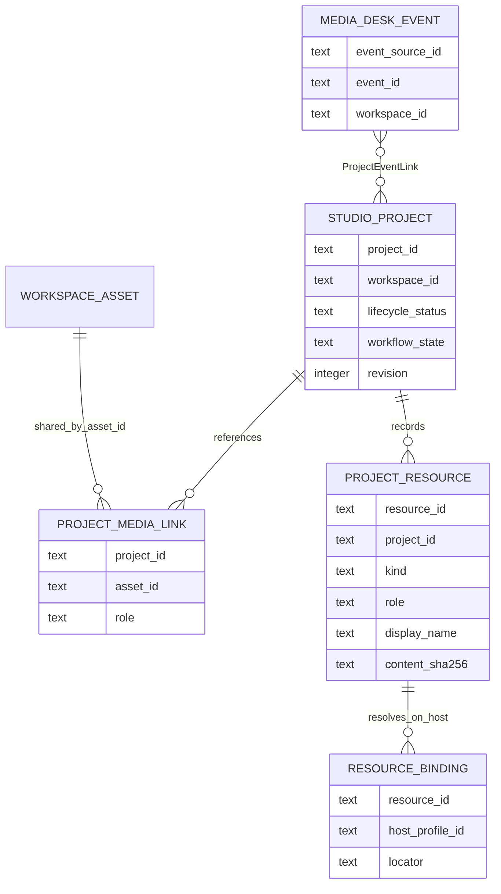

# Media Desk — audit projektového workflow

**Auditováno:** 2026-11-09

**Auditovaný integrační HEAD:** `bb9e2e2694653bd6c9abc37b743bec8bd5eab138`

**Větev:** `codex/media-desk-working-library-v1`
**Stav dokumentu:** **AKTUALIZOVÁNO PO INTEGRACI PROJECT CORE; DALŠÍ ROZŠÍŘENÍ
PROPOSED**

## 1. Závěr

Aktuální HEAD obsahuje integrovaný samostatný **Studio Project Core v1** se
správným vlastnictvím, stabilním `project_id`, vazbami na katalogová média bez
kopírování originálů, revizemi a archivací. Současně zachovává stabilní obsahovou
identitu média, read-only katalog, Media Desk-owned Events, lokální pracovní
knihovnu a virtualizovaný pohled nad knihovnou.

Project Core vznikl v pěti produkčních commitech na `feature/studio-shell` a po
dokumentační synchronizaci `bb9e2e2` byl 2026-11-09 integrován čistým
fast-forwardem. Vytvářet druhou projektovou entitu v Media Desku by proto byla
duplicita. Event–Project vazby, produkční workflow state, `ProjectResource` a
Scene Forge nadále nejsou implementované.

Nejmenší bezpečné cílové rozšíření je:

1. zachovat `Event` a `Project` jako dva samostatné agregáty;
2. znovu použít Studio `Project` a `ProjectMediaLink`;
3. doplnit Studio-owned many-to-many `ProjectEventLink` odkazující na existující
   Media Desk Event, bez kopie Eventu;
4. katalogová média a výstupy sdílet pouze přes `asset_id`;
5. nekatalogové pracovní soubory řešit samostatným `ProjectResource` a
   host-specific `ResourceBinding`, nikoli rozšiřováním workspace assetu;
6. virtuální galerie ponechat jako odvozené dotazy/pohledy, nikoli novou entitu;
7. Scene Forge případně připojit jako dalšího klienta Project Core, nikoli jej
   sloučit s Media Deskem nebo mu založit druhý typ projektu.

Tento směr vyžaduje nové schválené architektonické rozhodnutí, protože současný
Studio kontrakt výslovně nečte Media Desk user store a současná Event identita
není veřejný cross-application kontrakt.

## 2. Rozsah a metoda

Audit porovnal závazné dokumenty s aktuálním kódem, GUI a testy. Primárními
zdroji jsou [STATUS.md](STATUS.md), [ARCHITECTURE.md](ARCHITECTURE.md),
[DECISIONS.md](DECISIONS.md), [ROADMAP.md](ROADMAP.md), veřejný
[workspace kontrakt](../workspace-contract.md), `src/media_desk` a
`tests/media_desk`.

Původní read-only audit prozkoumal Git objekty `feature/studio-shell@543d3d6`,
které byly přímým potomkem tehdejšího HEAD `9b4d8ca`. Schválená konsolidace přidala
na Studio větev pouze dokumentační commit `bb9e2e2`, pushnula větev jako remote
zálohu a integrovala celou lineární historii pomocí `git merge --ff-only`.

Původní audit neměnil produkční kód, databázové schema ani testy. Následná
schválená integrace také nepřidala Event–Project vazbu, `ProjectResource`, změnu
workspace contractu ani migraci existujících Media Desk/ingest databází.

### 2.1 Konzistence dokumentace a kódu

Po integraci nebyl zjištěn materiální rozpor mezi
`STATUS.md`/`ARCHITECTURE.md`/`DECISIONS.md`, Studio dokumentací a implementací.
Dokumentační commit `bb9e2e2` opravil zastaralé tvrzení o absentním Launcher
hostingu a označil D-028 jako historický baseline překonaný v otázkách persistence
a Launcheru rozhodnutími D-029/D-030. Events zůstávají lokální Media Desk-owned
data, workspace zůstává read-only a Project Core je nyní implementovaná Studio-owned
součást HEAD.

## 3. Aktuální stav na HEAD

### 3.1 Vlastnictví a identity

| Koncept | Aktuální vlastník | Persistence / identita | Stav na HEAD |
|---|---|---|---|
| Workspace a katalog | Media Ingest | `workspace_id`, veřejný kontrakt v1 | **IMPLEMENTED** |
| Médium | Media Ingest | `asset_id = sha256:<64 hex>` | **IMPLEMENTED** |
| Session | Session Grouper | processor-owned immutable výstup | **IMPLEMENTED** |
| Event / „Akce“ | Media Desk | `event-<uuid4 hex>` v per-user JSON | **IMPLEMENTED** |
| Pracovní knihovna | Media Desk | názvy, Events a ruční přiřazení v per-user JSON | **IMPLEMENTED** |
| Virtualizovaná galerie | Media Desk UI/index | odvozený pohled, žádná vlastní entita | **IMPLEMENTED** |
| Produkční Project | HUHÁČ Studio / Project Core | `project-<uuid4 hex>` v oddělené Studio SQLite | **IMPLEMENTED** |
| Scene Forge | žádná implementace na HEAD | neexistuje | **ABSENT** |

Veřejný katalog vyžaduje shodu `asset_id == "sha256:" + sha256`; změna názvu
nebo umístění zdroje identitu média nemění, změna bajtů vytváří nový asset
([workspace-contract.md](../workspace-contract.md#public-contract),
[contract.py](../../src/media_desk/contract.py#L98-L105)). To je správná
identita pro sdílení média mezi více projekty.

### 3.2 Events

Event je uživatelská interpretace časových relací, nikoli Session a nikoli
produkční projekt. Datový model obsahuje `event_id`, jméno, jednu nebo více
`session_ids` a volitelné intervaly `[start, end)`
([models.py](../../src/media_desk/models.py#L78-L90)).

Media Desk user store má schema 2 a ukládá:

- stabilní katalogizační a zobrazovací názvy podle `asset_id`;
- Events;
- ruční `asset_id -> event_id | null` výjimky;
- monotónní revizi a jednorázovou provenance projekci
  ([user_data.py](../../src/media_desk/user_data.py#L18-L42),
  [user_data.py](../../src/media_desk/user_data.py#L150-L163)).

Store je `library-data/<workspace_id>.json` vedle Media Desk profilu, mimo
workspace. Zápis používá dočasný soubor, `fsync` a atomické `os.replace`
([user_data.py](../../src/media_desk/user_data.py#L39-L66)). Event ID je
serverem generované `event-<uuid4 hex>` a zápisy jsou chráněné revizí
([user_data.py](../../src/media_desk/user_data.py#L290-L329)).

Současná omezení jsou důležitá pro integraci:

- Event nelze vytvořit bez alespoň jedné existující Session
  ([user_data.py](../../src/media_desk/user_data.py#L310-L316));
- Event může zahrnout více Session a jednu Session lze časově rozdělit mezi více
  Events pomocí intervalů;
- jedno médium má v efektivním indexu nejvýše jeden Event: ruční výjimka má
  přednost, automatická vazba vznikne jen při právě jednom kandidátovi
  ([index.py](../../src/media_desk/index.py#L115-L145));
- Event ID je lokální k jednomu Media Desk user store. Samotné `workspace_id`
  není dostatečný identifikátor eventového datasetu, protože Launcher dovoluje
  více profilů s oddělenými user-data roots pro stejný workspace
  ([config.py](../../src/huhac_launcher/config.py#L58-L67),
  [DECISIONS.md](DECISIONS.md#d-026--launcher-v02-profiles-and-snapshot-selection)).

GUI `/events` umí create/update/delete, výběr více Session, split, posun sdílené
hranice a ruční přiřazení média
([events.html](../../src/media_desk/templates/events.html#L4-L69)). Zapisující
endpointy jsou `/events/save`, `/events/delete`, `/events/split`,
`/events/boundary` a `/events/assign`; po změně přepočítají in-memory index
([web.py](../../src/media_desk/web.py#L560-L715)).

Testy dokazují perzistenci a eventový filtr
([test_working_library.py](../../tests/media_desk/test_working_library.py#L74-L106)),
atomický half-open split, prioritu ruční výjimky a restartovou stabilitu
([test_working_library.py](../../tests/media_desk/test_working_library.py#L218-L312))
i kompatibilní načtení schema 1 do schema 2
([test_working_library.py](../../tests/media_desk/test_working_library.py#L312-L334)).

### 3.3 Pracovní knihovna

Pracovní knihovna již poskytuje stabilní per-workspace názvy, lokální Events,
lazy inline video, sdílenou browser-local hlasitost, eventové filtrování a
bezpečné otevření originálu. Jednoznačný původní název může být jednorázově
promítnut z Media Connector provenance; jinak vznikne stabilní `IMG-####` nebo
`VID-####`. Pozdější requesty ani restarty už Connector manifest nepotřebují
([user_data.py](../../src/media_desk/user_data.py#L174-L217),
[user_data.py](../../src/media_desk/user_data.py#L240-L271)).

Pracovní knihovna ale neobsahuje projekty, pracovní soubory, produkční stav,
projektové výstupy ani obecný multi-select pro projektové operace. Eventové
`manual_assignments` jsou výjimky z časového přiřazení, nikoli projektové media
links.

### 3.4 Virtual Galleries

V aktuální implementaci neexistuje doménová nebo perzistentní entita
`VirtualGallery`. Existuje virtualizované GUI `/library`: klient renderuje pouze
viditelné řádky s overscanem, používá dávkové API a obnovuje kotvu
([library.html](../../src/media_desk/templates/library.html#L24-L46),
[library.js](../../src/media_desk/static/library.js#L238-L318)).

`LibraryIndex` je odvozený in-memory index. Filtruje podle typu, textu, data,
Eventu a normalizovaných facetů, řadí deterministicky a seskupuje podle
efektivního Eventu ([index.py](../../src/media_desk/index.py#L168-L228)). Cursor
je vázaný na snapshot a fingerprint dotazu
([index.py](../../src/media_desk/index.py#L259-L302)). `/api/index` vrací počty,
časové segmenty, sekce, eventovou revizi a facety
([web.py](../../src/media_desk/web.py#L1204-L1231)).

Soubor `templates/gallery.html` je pozůstatek starší server-rendered galerie;
aktuální aplikace pro něj nemá `/gallery` route. Nesmí být interpretován jako
hotová „virtuální galerie“ nebo kolekce.

**Důsledek:** eventová, projektová nebo výstupní galerie má být pouze uložený či
aktuální query/view nad existujícími vazbami. Nová tabulka `galleries` není pro
požadovaný model potřeba.

### 3.5 Originály a mapování mezi hostiteli

Media Desk originály nevlastní ani nekopíruje. Katalog nese absolutní
`source_root` posledního ingest hostitele a relativní POSIX cesty. S2a mapping
váže přesnou trojici významů `workspace_id + catalog source_root -> local_root`,
je uložen jen v lokálním profilu a před uložením používá reprezentativní SHA-256
vzorek ([originals.py](../../src/media_desk/originals.py#L179-L238),
[originals.py](../../src/media_desk/originals.py#L241-L385)).

Každý přístup k originálu znovu ověřuje relativní cestu, canonical containment a
symlink escape. Token obsahuje binding epoch odvozenou z workspace, katalogového
kořene a aktivního lokálního kořene
([contract.py](../../src/media_desk/contract.py#L141-L179)). Změna mappingu proto
zneplatní starý token; test je v
[test_web.py](../../tests/media_desk/test_web.py#L262-L297). Startup a metadata
requesty jednotlivé originály neotevírají ani nehashují
([test_web.py](../../tests/media_desk/test_web.py#L300-L343)).

Projektové rozšíření nesmí tuto hranici měnit. Projekt odkazuje na `asset_id`, ne
na absolutní originální cestu. Host mapping zůstává odpovědností existujícího
catalog/original adapteru.

## 4. Integrovaný projektový koncept

### 4.1 Studio Project Core v1

Na aktuálním HEAD je **IMPLEMENTED**:

- `Project` se serverem generovaným `project-<uuid4 hex>`, jedním immutable
  `workspace_id`, názvem, popisem, poznámkami, tags, revizí a lifecycle stavem
  `active|archived`;
- `ProjectMediaLink` s primárním klíčem `(project_id, asset_id)`, rolí
  `source|reference|deliverable`, poznámkou a pořadím;
- Studio-owned host-local SQLite v `%LOCALAPPDATA%`, single-writer lock,
  transakce, `foreign_keys`, WAL, `synchronous=FULL`, integrity check a backup;
- FastAPI Project service a React moduly Projekty a Mediální knihovna;
- read-only katalogovou projekci, preview, bezpečný video Range endpoint a
  přidávání/odebírání projektových media links bez změny originálu.

Důkazy na HEAD:

- [PROJECT_CONTRACT.md](../studio/PROJECT_CONTRACT.md);
- [database.py](../../src/huhac_studio/database.py);
- [service.py](../../src/huhac_studio/service.py);
- [test_project_service.py](../../tests/studio/test_project_service.py);
- [test_project_web.py](../../tests/studio/test_project_web.py).

Project Core již splňuje:

- projekt bez Eventu i bez média;
- stejné médium v libovolném počtu projektů přes samostatné relation rows;
- nulové kopírování originálů;
- zachování vazby při offline nebo dočasně chybějícím assetu;
- katalogový výstup jako `ProjectMediaLink(role="deliverable")`;
- archivaci/restore a revision concurrency.

Project Core zatím nesplňuje:

- vazbu Project–Event;
- produkční workflow stav odlišný od lifecycle `active|archived`;
- nekatalogové pracovní soubory, pracovní adresář a host-specific relink;
- obecnou evidenci výstupů, které ještě nejsou ingestované jako katalogový asset;
- přenosný export/import.

#### Integrační ověření 2026-11-09

- Studio backend: **25 passed, 1 platformní skip**;
- Launcher: **57 passed**;
- Media Desk regrese: **95 passed, 6 platformních skipů**;
- Studio frontend: **27 passed v 6 souborech**;
- produkční TypeScript/Vite build: **PASS**, 87 modulů;
- provozní smoke: dočasný ingest-owned workspace, online Studio session, frontend
  HTTP 200 a vytvoření/načtení projektu v izolované schema-1 SQLite;
- provozní `%LOCALAPPDATA%\HUHAC\Studio\projects.sqlite3` měla před a po smoke
  shodnou délku i timestamp.

Hostitelský PowerShell `Start-Process` odmítal zděděné duplicitní `Path`/`PATH`.
Finální smoke proto použil přímý `.NET ProcessStartInfo`; Studio proces, API i
izolovaná databáze následně fungovaly bez odchylky.

### 4.2 Scene Forge / SceneForge

Na aktuálním HEAD není žádný Scene Forge kód, API, schema ani dokumentovaný
kontrakt. V [Studio README](../studio/README.md) je Scene Forge výslovně označen
jako **ABSENT**. Neexistuje tedy
doložený koncept „SceneForge Project“, který by bylo možné bezpečně sloučit s
Media Deskem.

Pokud Scene Forge vznikne jako modul Studia, má používat stejný `project_id` a
Project Core API. Pokud je nebo bude samostatnou aplikací s vlastní entitou,
musí nejprve vzniknout explicitní mapping/adapter a rozhodnutí o source of truth.
Bez takového kontraktu se Scene Forge nesmí vydávat za vlastníka projektů ani
automaticky slučovat s Media Desk Events.

## 5. Porovnání požadovaného modelu

| Požadavek | Media Desk / základ | Integrovaný Project Core | Gap / závěr |
|---|---|---|---|
| Event sdružuje více projektů | **ABSENT** | **ABSENT** | Potřeba many-to-many link |
| Projekt bez Eventu | Event vazba **ABSENT** | **IMPLEMENTED** | Zachovat volitelnou vazbu |
| Projekt ve více Events | **ABSENT** | **ABSENT** | Potřeba many-to-many link |
| Média sdílená odkazy | Stabilní `asset_id` existuje | **IMPLEMENTED** přes `ProjectMediaLink` | Znovu použít, nekopírovat |
| Pracovní soubory | **ABSENT** | **DEFERRED** | `ProjectResource` + host binding |
| Výstupy | Jen katalog/processor artefakty bez projektu | `deliverable` pro katalogový asset | Nekatalogové výstupy řešit resource |
| Stav projektu | **ABSENT** | Jen lifecycle `active|archived` | Workflow stav je samostatné rozhodnutí |
| Virtual Galleries | Virtualizovaný view, ne entita | Projektový/all-media view | Nepřidávat duplicitní gallery entity |
| SceneForge projekty | **ABSENT** | Scene Forge **ABSENT** | Budoucí klient Project Core |

## 6. Navržený minimální datový model

Následující model je **PROPOSED**, nikoli schválený kontrakt.

### 6.1 Zachovat beze změny

- `EventRecord` a Media Desk user store zůstávají Media Desk-owned.
- `Project` a `ProjectMediaLink` zůstávají Studio-owned.
- Workspace v1, ingest SQLite, katalog a originály se nemění.
- Projektová média jsou odkazy na `asset_id`; projekt nikdy nevlastní originál.
- Katalogový výstup je media link s rolí `deliverable`, nikoli kopie souboru.

### 6.2 `ProjectEventLink`

Minimální nová vazba v Project Core:

| Pole | Pravidlo |
|---|---|
| `project_id` | FK na existující Studio Project |
| `event_source_id` | identita konkrétního Event store/profile, ne jen workspace |
| `event_id` | existující `event-<uuid4 hex>` |
| `created_at` | serverový UTC timestamp |

Primární klíč má být `(project_id, event_source_id, event_id)`. Projekt může mít
nula až N Events; Event může být zpětným dotazem spojen s nula až N Projects.
Link nenese kopii názvu, Session ani seznamu médií. Eventová média automaticky
nezakládají projektové media links a projektová média automaticky nemění Event.

Při vytvoření se musí ověřit:

1. Project je aktivní;
2. Event existuje v explicitně vybraném Event source;
3. `workspace_id` Projectu a Event source se shodují;
4. očekávaná project revision se shoduje.

Pozdější nedostupný Event store nebo smazaný Event nesmí link automaticky
smazat. Query vrátí `resolved`, `event_source_unavailable` nebo
`event_missing`; odstranění je explicitní command. Tím se používá stejný
bezpečný princip jako u offline `ProjectMediaLink`.

### 6.3 Event read contract

Současný Media Desk nemá veřejné strojové Event API. `/api/index` vrací pouze
odvozené sekce pro aktuální query, nikoli úplný autoritativní Event kontrakt.
Přímé parsování privátního JSON z Project service by bez rozhodnutí porušilo
současné oddělení vlastníků.

Nejmenší provozně použitelné rozšíření je verzovaný read-only Event snapshot
contract/port:

- vstup je explicitní Event source vybraný z profilu, nikdy autodetekce podle
  nejnovějšího souboru;
- výstup obsahuje `event_contract_version`, `event_source_id`, `workspace_id`,
  `revision` a Events s ID/názvem; pro projektové linkování nejsou potřeba kopie
  assetů ani intervalů;
- adapter plně validuje schema a identitu, ale nic nezapisuje;
- Media Desk zůstane jediným writerem Event store;
- Studio Project Core ukládá pouze reference a diagnostický stav.

Přímý live HTTP call do Media Desku není doporučené minimum: současný Launcher
vlastní právě jeden child a Studio/Media Desk neběží současně. Duplikovat Events
do Studio SQLite nebo je přesunout z Media Desku je také nevhodné, protože by
vznikl druhý source of truth nebo porušení ownershipu.

`event_source_id` je nutná otevřená identita. `workspace_id` samo nestačí.
Možnosti jsou stabilní UUID Event store uložené v budoucím kompatibilním schema,
nebo explicitní stabilní profilová identita. Absolutní cesta nesmí být veřejnou
nebo přenosnou identitou.

### 6.4 Produkční stav

Existující `status = active|archived` je lifecycle, ne produkční workflow.
Nemá se přejmenovat ani rozšířit o desítky stavů, protože by se změnila
archivační sémantika.

Pokud uživatel potřebuje produkční stav, doplní se samostatné volitelné
`workflow_state`. Pro zpětnou kompatibilitu musí staré projekty dostat
`unspecified` a chovat se stejně jako dnes. Konkrétní enum, například
`planned|in_progress|review|delivered|on_hold`, vyžaduje produktové schválení;
tento audit jej neschvaluje.

### 6.5 Pracovní soubory a nekatalogové výstupy

Znovu použít návrh z
[PROJECT_ARCHITECTURE_REVIEW.md](../studio/PROJECT_ARCHITECTURE_REVIEW.md):

- `ProjectResource` drží logickou metadata referenci na `external_file`,
  `external_directory` nebo `url`, roli, display name, poznámku a volitelný hash;
- `ResourceBinding` drží host-specific locator odděleně podle profilu/hostitele;
- absolutní cesta se nepřenáší jako aktivní binding na jiný host; vyžaduje
  explicitní relink;
- Project Core soubor nekopíruje, nemění a bez samostatného bezpečnostního návrhu
  jej ani obecně neservíruje.

Role mají rozlišit alespoň `working_file`, `working_directory` a
`external_output`. Jakmile se výstup stane podporovaným katalogovým médiem,
přidá se jako `ProjectMediaLink(role="deliverable")`; resource může zůstat jako
provenance nebo být explicitně nahrazen, nikdy automaticky podle názvu.

### 6.6 Virtuální projektové galerie

Nevytvářet `VirtualGallery` tabulku. Potřebné pohledy jsou odvozené:

- Event gallery = existující `QuerySpec(event_id=...)`;
- Project gallery = media links aktivního Projectu rozřešené proti katalogu;
- Event + Project gallery = průnik zvolených `asset_id`, pokud jej UI potřebuje;
- Deliverables = Project gallery filtrovaná rolí `deliverable`;
- Unresolved = Project links bez aktuálně dostupného katalogového assetu.

Uložený filtr lze případně dodat později jako samostatnou user preference, ne
jako nový vlastník médií.

## 7. Navržený UI workflow

### 7.1 Primární surface: HUHÁČ Studio

Projektové workflow má patřit Studiu, protože tam již existuje Project Core,
project revision a projektový multi-select. Media Desk zůstane specializovaný
na Event editaci a detailní knihovnu.

1. **Projekty:** uživatel vytvoří projekt bez povinného Eventu nebo média.
2. **Detail projektu:** metadata, lifecycle, budoucí workflow state, linked
   Events, média, resources a výstupy jsou samostatné sekce.
3. **Připojit Event:** multi-select čte autoritativní Event snapshot stejného
   workspace; uložení vytvoří jen `ProjectEventLink`.
4. **Mediální knihovna:** stávající all-media/project přepínač a multi-select
   přidá `ProjectMediaLink`; Event lze použít jako vstupní filtr, ne jako
   automatické hromadné vlastnictví.
5. **Pracovní soubory:** uživatel založí resource metadata a na konkrétním hostu
   explicitně zvolí/relinkne binding.
6. **Výstupy:** ingestované médium se označí rolí `deliverable`; nekatalogový
   soubor zůstává `external_output` resource.
7. **Offline stav:** projekt i linky zůstanou čitelné; UI ukáže unresolved
   diagnostiku a nenabízí destruktivní automatickou opravu.

### 7.2 Media Desk

Nejmenší první etapa Media Desk GUI nemění. Pozdější volitelné rozšíření může na
`/events` zobrazit read-only počet a seznam připojených projektů získaný přes
Project API. Media Desk nesmí projekty vytvářet přímým zápisem do Studio SQLite.
Pokud Project service není dostupný, Event editor musí plně fungovat jako dnes.

### 7.3 Scene Forge

Budoucí Scene Forge modul otevře existující `project_id` a používá Project Core
query/command API. Jeho specifické scene/timeline/render entity patří do jeho
vlastního namespace a odkazují na Project; nesmějí změnit význam Media Desk
Eventu. Integrace Scene Forge není podmínkou Event–Project linku.

## 8. Rizika a zpětná kompatibilita

| Riziko | Dopad | Ochrana |
|---|---|---|
| Event ID není globální přes více Media Desk profilů | Link může ukázat na jiný/žádný Event | Zavést explicitní `event_source_id`; nevázat jen na workspace/path |
| Dva writery a dvě revize | Nelze udělat atomickou transakci přes JSON a SQLite | Event zůstane read-only reference; project link command je jedna Studio transakce |
| Smazání Eventu | Dangling project reference | Zachovat link + diagnostika; explicitní unlink |
| Nedostupný user-data root | Project detail nemůže Event rozřešit | Offline stav, žádný auto-delete |
| Smíchání Event a Project | Duplicitní lifecycle a konfliktní ownership | Samostatné agregáty + join entity |
| Automatické přidání všech eventových médií do projektu | Nechtěné a těžko vratné vazby | Event je filtr/kontekst; media links vznikají explicitně |
| Pracovní soubor vydávaný za asset | Nestabilní ID a rozbitý processor contract | `ProjectResource`, ne workspace asset |
| Absolutní resource path na jiném hostu | Neplatný nebo nebezpečný locator | Oddělený host binding + explicitní relink |
| Workflow enum změní dnešní archive chování | Regrese existujících projektů | Oddělit `workflow_state`, default `unspecified` |
| Přímé čtení privátního Media Desk JSON | Tichá závislost na schema/path | Nejprve schválit a verzovat Event read contract |
| Scene Forge zavede druhý projekt | Rozštěpený source of truth | Povinné použití Project Core nebo explicitní adapter |

Audit ani první Project-side vazba nemění workspace contract v1, ingest SQLite,
asset IDs, Session Grouper output ani origin mapping. Varianta, která odvodí
`event_source_id` z již stabilní profilové identity, může ponechat Media Desk
Event schema 2; store-owned UUID by naopak vyžadovalo samostatně schválenou
kompatibilní migraci user store. Existující projekt bez nových vazeb se chová
jako dnes. Všechny nové vazby a resources jsou volitelné a additivní.

## 9. Malé samostatně testovatelné implementační úlohy

Implementaci lze zahájit až po schválení vlastnictví a identity Event source.

1. **ADR a dokumentační synchronizace.** Schválit Project Core jako jedinou
   projektovou entitu, Event ownership, `event_source_id`, cross-store offline
   pravidla a oddělení lifecycle/workflow. Bez produkční změny.
2. **COMPLETED 2026-11-09 — Konsolidace Project Core.** Celá lineární
   `feature/studio-shell` byla po dokumentační synchronizaci integrována
   fast-forwardem. Event link nebyl přidán; prošly Studio backend/frontend,
   Launcher a Media Desk regrese i izolovaný provozní smoke.
3. **Read-only Event contract.** Formalizovat minimální snapshot a parser/adapter;
   žádné write API. Testy: schema/version, workspace/source identity, poškozený a
   nedostupný store, více profilů stejného workspace, nulové změny souborů.
4. **ProjectEventLink schema a service.** Jedna additivní Studio migrace, composite
   PK, revision-guarded link/unlink a unresolved query. Testy: 0..N/N..N,
   workspace mismatch, stale revision, archive, missing Event, rollback.
5. **ProjectEventLink API.** Batch GET/POST/DELETE přes existující loopback,
   Host/Origin/CSRF/body/If-Match ochrany. Testy HTTP kontraktu a odmítnutí
   klientských Event detailů/pathů.
6. **Studio UI — Events v detailu projektu.** Read-only seznam a explicitní
   link/unlink. Projekt bez Eventu zůstane plnohodnotný. Testy loading/offline,
   více Events, více Projects na Event, 409 refresh.
7. **Event jako filtr knihovny.** Znovu použít existující eventové rozlišení a
   projektový multi-select; nepřidávat gallery store. Testy průniku filtrů,
   stabilních `asset_id` a nulového kopírování.
8. **Workflow state.** Až po schválení enumu doplnit additivní pole s defaultem
   `unspecified`, API a UI. Testy migrace staré DB a nezměněné archive/restore.
9. **ProjectResource metadata.** Přidat resource bez bindingu a bez file serveru.
   Testy ID, role, hash, revision, archive a nulové filesystem změny.
10. **ResourceBinding/relink.** Samostatná host-specific etapa s confinement,
    symlink a offline testy. Nesmí měnit S2a origin mapping.
11. **Volitelná read-only projekce do Media Desku.** Event stránka může zobrazit
    linked Projects přes Project API; při nedostupnosti se degraduje bez změny
    Event workflow.
12. **Scene Forge adapter až nakonec.** Scene Forge otevře existující Project Core
    projekt; samostatné acceptance testy musí prokázat, že nevytváří druhou
    projektovou identitu ani nezapisuje Media Desk store.

Každá úloha má vlastní dokumentační synchronizaci a nesmí být označena
**IMPLEMENTED**, dokud neprojde cílenými testy a code-versus-documentation
kontrolou.

## 10. Otevřené architektonické otázky

1. Co je stabilní `event_source_id`: UUID uložené v Media Desk user store,
   Launcher profile ID, nebo jiná explicitní identita? Absolutní cesta není
   vhodná identita.
2. Má Studio číst verzovaný Event snapshot přímo read-only, nebo vznikne malá
   lokální Event query služba? Současný one-child Launcher vylučuje závislost na
   současně běžícím Media Desk procesu jako výchozí řešení.
3. Má Project Core povolit link na Event pouze při online validaci, nebo také
   importovat již známou unresolved referenci? Doporučený běžný command je
   online-only; import vyžaduje samostatnou politiku.
4. Jaký přesný produkční workflow enum je potřebný a kdo vlastní jeho přechody?
   `active|archived` musí zůstat lifecycle.
5. Které pracovní soubory mají být pouze evidované reference a které má budoucí
   aplikace bezpečně otevírat? Obecný file server není součástí návrhu.
6. Kdy se nekatalogový výstup „promuje“ na katalogový `deliverable` asset a jak
   se zachová provenance mezi resource a assetem?
7. Potřebují ProjectEventLink a resources přenosný export, nebo první etapa
   zůstane stejně jako dnešní Project Core a Events host-local?
8. Má Media Desk vůbec zobrazovat projekty, nebo bude reverse Event -> Projects
   pouze ve Studiu? První varianta rozšiřuje runtime závislosti Media Desku.
9. Existuje mimo tento repozitář autoritativní SceneForge project contract? Pokud
   ano, musí být porovnán s Project Core před jakoukoli integrací.

## 11. Doporučená rozhodovací brána

Před implementací schválit jediný nový architektonický balíček:

- Studio Project Core je jediný vlastník produkčních projektů;
- Media Desk je jediný vlastník současných Events;
- Event–Project je Studio-owned reference s explicitním Event source;
- média se sdílejí pouze přes `asset_id`;
- pracovní soubory jsou resources s host bindings;
- Scene Forge je budoucí klient Project Core;
- virtuální galerie jsou view/query, ne vlastník nebo kopie dat.

Teprve potom má smysl implementovat úlohy 3–5. Bez tohoto schválení by i malá
změna schema vytvořila nový materiální architektonický závazek v rozporu s
[AGENTS.md](../../AGENTS.md).
